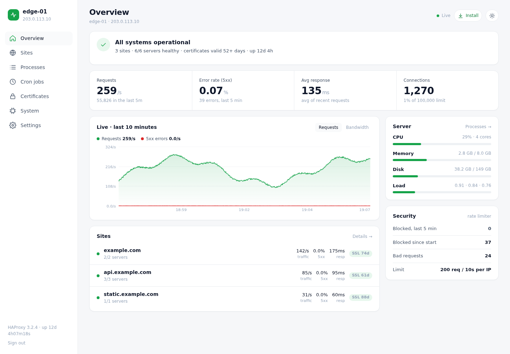
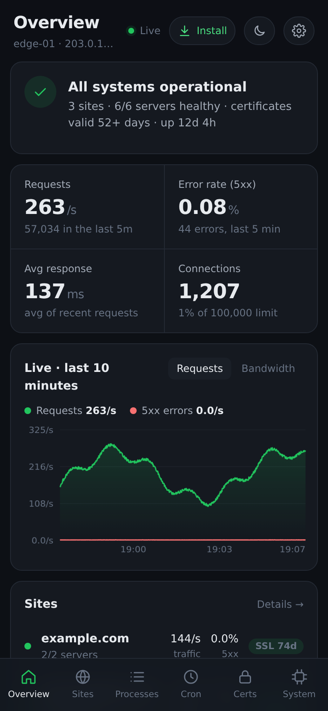
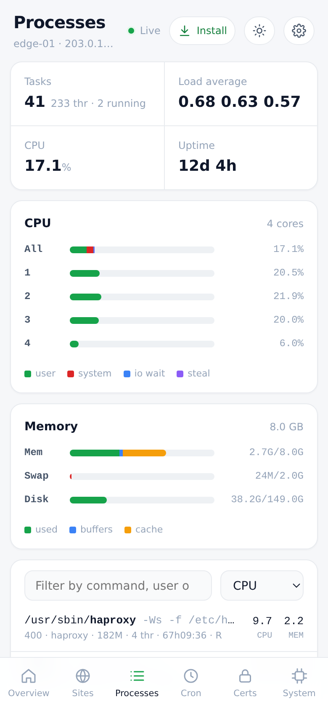
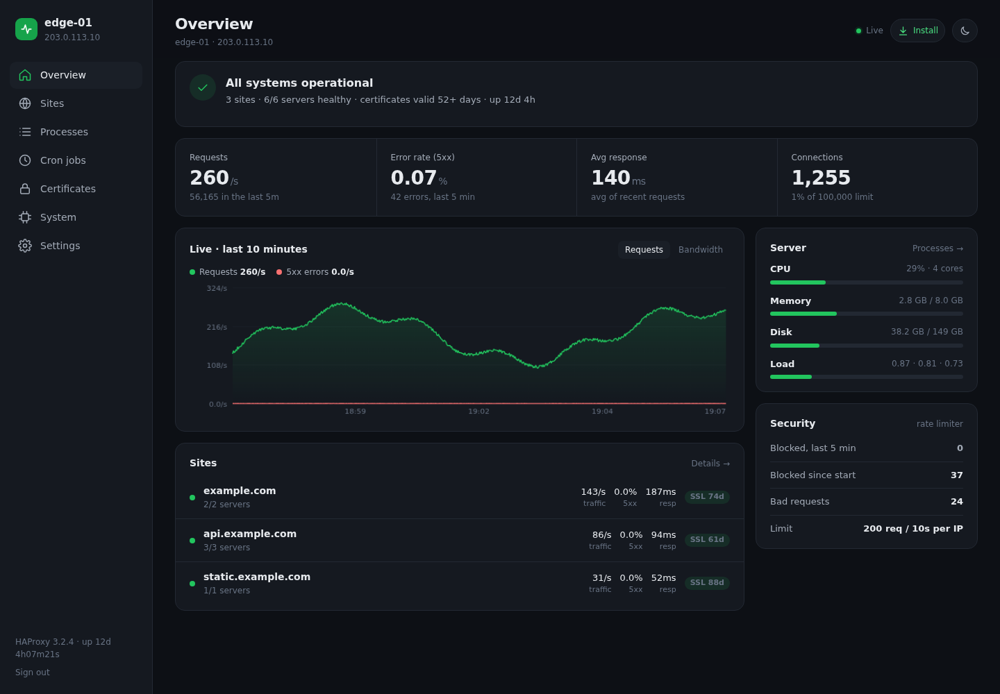
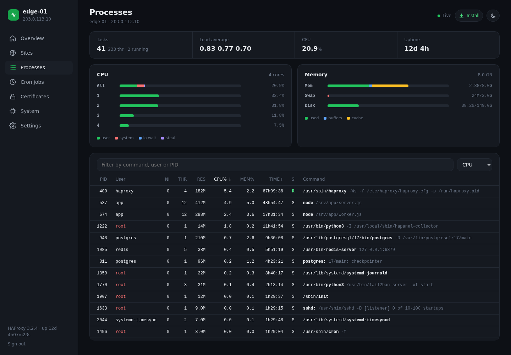
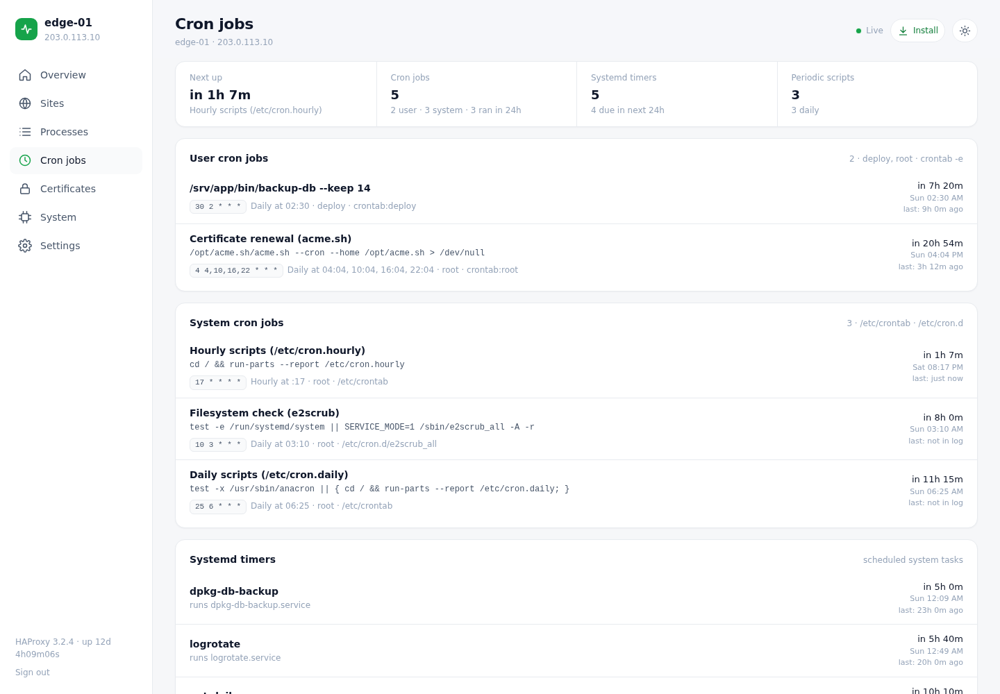
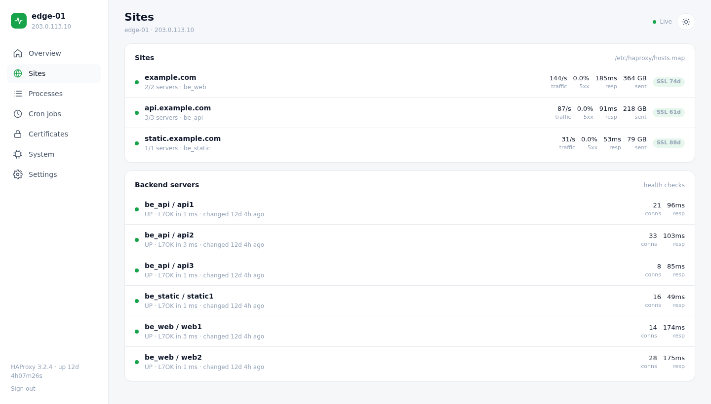
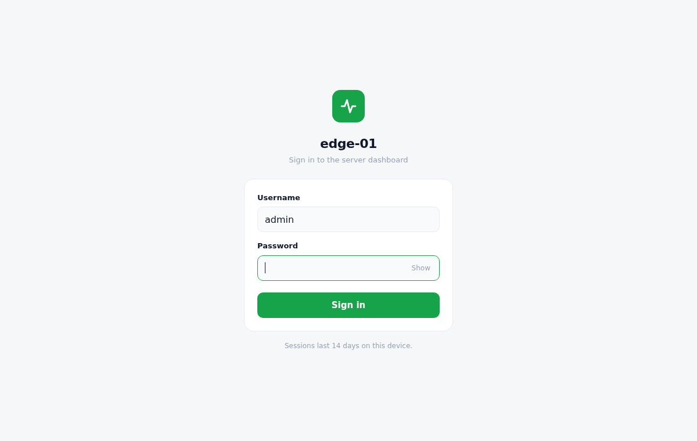

# HAPanel

**A lightweight, real-time server dashboard that runs inside HAProxy.**

HAPanel turns an HAProxy edge server into a live control panel: traffic, errors, response times, site health,
certificates, processes, cron jobs and system resources, updated every second. It is served by HAProxy itself
through its built-in Lua support, so there is **no extra web server, no database, no Docker and no Node.js**,
just a few files and one small Python collector that uses only the standard library.

It's an educational project: the code is small enough to read in an afternoon and shows how far you can get with
HAProxy's Lua API, Server-Sent Events and plain HTML/CSS/JS.



<p align="center">
  
  &nbsp;&nbsp;
  
</p>

> All screenshots use the bundled demo with simulated data (documentation IP ranges and example.com domains).

## Features

- **Real-time:** one Server-Sent Events stream pushes a fresh snapshot every second, with no polling. It reconnects
  automatically and pauses while the tab is hidden.
- **Health at a glance:** a single verdict ("All systems operational", "Needs attention", "Action needed") with
  plain-English issues: backend down, 5xx rate, slow responses, expiring certificates, CPU/RAM/disk pressure,
  connection limit, missing certificate renewal job, stale metrics.
- **Key numbers:** requests/s, 5xx error rate over the last 5 minutes, average response time, and connections vs. maxconn.
- **Sites:** status, traffic, errors, latency and certificate days left for every domain in `hosts.map`, plus
  backend servers with health-check results.
- **Processes:** an htop-style view with per-core CPU bars, memory/swap/disk meters, and a sortable, filterable
  process list.
- **Cron jobs:** user and system crontabs with plain-English schedules ("Daily at 04:04"), live countdowns to the
  next run and the last run from the journal, plus systemd timers and `/etc/cron.*` scripts.
- **Certificates:** every certificate HAProxy serves, with issuer, expiry date and days left.
- **Security card:** requests blocked by your rate limiter and malformed requests.
- **Installable PWA:** add it to your phone or desktop as an app. The server name you choose becomes the app name.
- **Login with server-side sessions:** HttpOnly cookie, hashed tokens, sign out (or sign out every device),
  change password, lockout after repeated failures, CSRF protection.
- **Clean, modern UI:** light/dark/auto theme, designed mobile-first with a bottom tab bar on phones.

<details>
<summary><b>More screenshots</b></summary>

| | |
|---|---|
|  |  |
|  |  |



</details>

## How it works

```
 browser / PWA ──HTTPS──▶ HAProxy ─┬─ lua.dashboard  page (server name filled in)
                                   ├─ lua.live       SSE stream, 1 update/s
                                   │     ├─ HAProxy counters read straight from memory (core.frontends/backends)
                                   │     └─ /var/lib/haproxy/hapanel/sys.json  ◀── hapanel-collector (Python, root)
                                   ├─ lua.login / logout / password / settings
                                   └─ lua.static     manifest, service worker, icons
```

| Piece | What it does |
|---|---|
| `panel/hapanel.lua` | All HTTP endpoints, sessions, login, settings and the live stream. Loaded with `lua-load`. |
| `panel/index.html`, `login.html` | The UI: one HTML file each, no build step, no external requests. |
| `collector/hapanel-collector` | Reads `/proc`, crontabs, systemd timers and certificates, and writes one JSON file every second. Standard library only. |
| `tools/hapanel-passwd` | Sets or resets the password from the shell. |
| `tools/demo_server.py` | Runs the UI with simulated data, no HAProxy needed. |

## Try the demo

```bash
git clone https://github.com/agentnc/HAPanel.git
cd HAPanel
python3 tools/demo_server.py          # → http://localhost:8080/hapanel/
```

Any password works on the demo login page.

## Requirements

- Linux with systemd (tested on Debian 13)
- **HAProxy 3.1 or newer** built with Lua (`haproxy -vv | grep USE_LUA`). Tested on 3.2 LTS.
- Python 3.9+ (for the collector and password tool)
- TLS certificates in a directory HAProxy loads (`crt /etc/haproxy/certs/`)

## Installation

```bash
# 1. Panel files
sudo mkdir -p /etc/haproxy/hapanel
sudo cp panel/* /etc/haproxy/hapanel/

# 2. Runtime directories inside HAProxy's chroot
sudo install -d -m 755 /var/lib/haproxy/hapanel
sudo install -d -m 700 -o haproxy -g haproxy /var/lib/haproxy/hapanel/state

# 3. Collector
sudo install -m 755 collector/hapanel-collector /usr/local/sbin/
sudo install -m 644 collector/hapanel-collector.service /etc/systemd/system/
sudo systemctl daemon-reload
sudo systemctl enable --now hapanel-collector

# 4. Password tool + set your password (user: admin)
sudo install -m 700 tools/hapanel-passwd /usr/local/sbin/
sudo hapanel-passwd
```

**5. HAProxy config.** Merge the relevant parts of [`examples/haproxy.cfg`](examples/haproxy.cfg) into yours:

- in `global`: `tune.lua.bool-sample-conversion normal` and `lua-load /etc/haproxy/hapanel/hapanel.lua`
- in your HTTPS frontend: the block marked `HAPanel`, with `panel.example.com` replaced by your hostname

```bash
sudo haproxy -c -f /etc/haproxy/haproxy.cfg && sudo systemctl reload haproxy
```

Open `https://<your-host>/hapanel/`, sign in, then set the server name in **Settings**.

### Configuration

- **Thresholds and labels:** at the top of the `<script>` in `panel/index.html` (`HIDDEN`, `RATE_LIMIT_LABEL`,
  `RENEWAL_CRON`, and the `T` thresholds for warnings).
- **Collector paths:** `HOSTS_MAP` and `CERT_DIR` at the top of `collector/hapanel-collector`.
- **URL path:** the panel lives under `/hapanel/`. To use another path, replace `/hapanel/` in `panel/*` and in your
  HAProxy config.
- **Session length and lockout:** `SESSION_TTL`, `MAX_FAILS`, `LOCK_SECONDS` in `panel/hapanel.lua`.

HAProxy reads the panel files at startup: run `systemctl reload haproxy` after editing them.

## Security notes

- Every panel URL except the login page and the PWA files (manifest, service worker, icons) requires a valid session.
- Session tokens are 256-bit random values in an `HttpOnly; Secure; SameSite=Lax` cookie. The server stores only
  their SHA-256, so a leaked sessions file can't be used to sign in. Signing out deletes the session on the server.
- Passwords are stored as an iterated, salted SHA-256 hash. Five wrong attempts lock that IP out for 15 minutes.
- State-changing requests require a custom header, which browsers can't send cross-site without a CORS preflight
  (and none is ever allowed).
- The Processes page shows full command lines, which can include secrets passed as arguments. Treat panel access
  like shell access. Consider extra protection in front of it (VPN, IP allow-list or an access proxy).
- The collector runs as root to read crontabs and certificates. It only writes its own JSON file.

## Uninstall

```bash
sudo systemctl disable --now hapanel-collector
sudo rm -f /etc/systemd/system/hapanel-collector.service /usr/local/sbin/hapanel-collector /usr/local/sbin/hapanel-passwd
sudo rm -rf /etc/haproxy/hapanel /var/lib/haproxy/hapanel
# then remove the HAPanel lines from haproxy.cfg and reload HAProxy
```

## License

[MIT](LICENSE)
